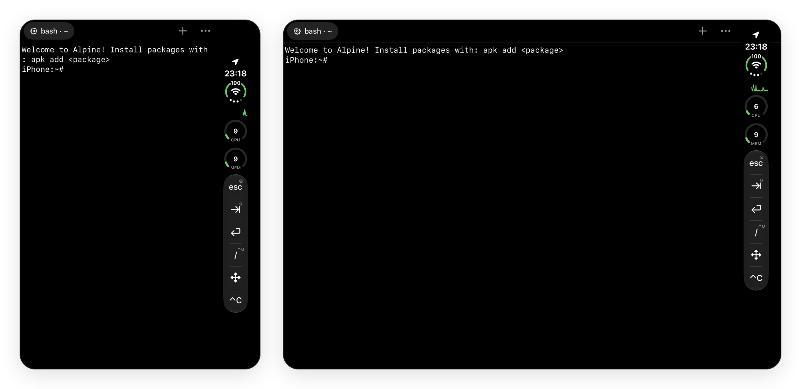
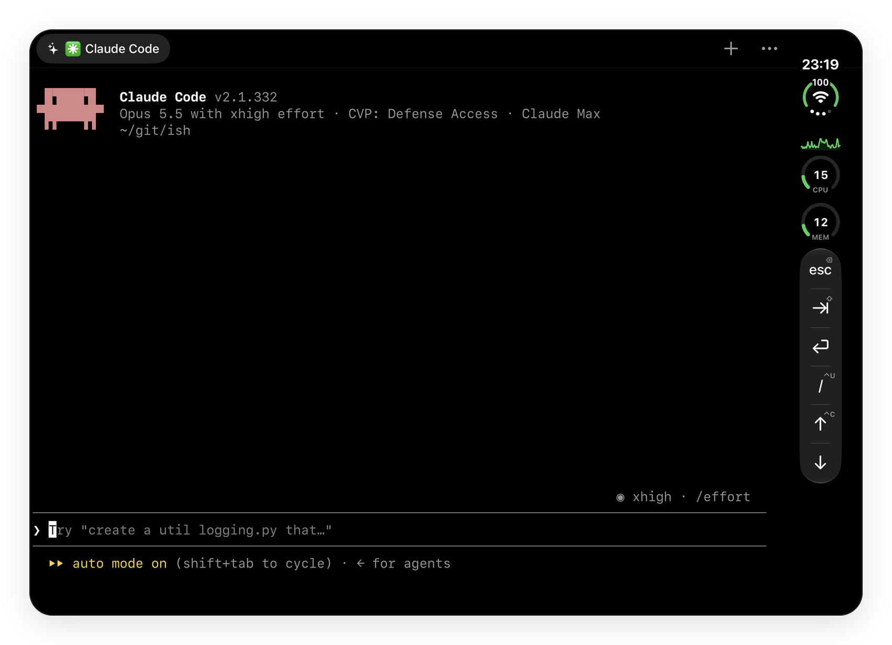

# [iSH](https://ish.app)

> ## 🚀 ARM64 Fork Notice
>
> **This repository is a fork of [ish-app/ish](https://github.com/ish-app/ish)** that runs
> **AArch64 Linux on iPhone and iPad**, made for the **foldable iPhone** first. The guest is
> AArch64 only: upstream's x86 (i386) guest and its Linux-kernel variant (iSH+Linux) have been
> removed.
>
> **Guest code runs three ways**, each taking what the one before cannot:
> - **AOT images**: native translations of the code that matters in bash, busybox, musl,
>   Python, Node.js, Claude Code, the JVM, git, gh, OpenSSH and OpenSSL, recorded by CI and
>   linked into the app. They run as native code with nothing more needed.
> - **Built-in JIT** (`asbestos/guest-arm64/jit.c`): translates the rest at run time, into a
>   code region iOS lets run once a debugger has had the app (on iOS 26 with TXM, one the
>   debugger prepared). iSH is its own debugger's client: an extension of the app attaches
>   [StikJIT](https://github.com/zhkl0228/StikJIT) through a loopback VPN to the device's own
>   services, prepares the region and detaches, a few seconds after the app starts. It needs
>   Developer Mode, a development-signed app and a pairing file, which iOS 27 lets iSH make on
>   the device itself (Settings → Built-in JIT).
> - **Asbestos**: upstream's threaded-code interpreter, with this fork's hand-written ARM64
>   gadgets, a handful of host instructions for each guest instruction and no executable memory.
>   All code runs here until the JIT has its region, and without one.
>
> **And:**
> - **48-bit virtual address space**: a 4-level page table, for the V8, Go and Rust runtimes
> - **`ish-install`** on an **Alpine 3.24** root: Python 3.14, Node.js 24, Claude Code, Kimi Code,
>   Go, OpenJDK 25, gcc, clang, Redis and MariaDB, by group or all at once (`--cn` for mirrors in
>   China), and bash, zsh or fish as root's shell
> - **Full NEON + Crypto**: AES, SHA and CRC32 instructions for TLS and hashing
> - **The foldable iPhone's column**: the right edge iOS gives the status bar carries the device's
>   CPU, memory and JIT meters, and keys that follow what runs (esc, tab, return and /; the arrows'
>   pad and Ctrl-C, or an AI agent's up and down arrows; `:` for vi, space and q for a pager)
> - **Terminal**: tabs that come back in their directories, a clipboard history, programs'
>   notifications (the bell, OSC 9 and 777), a keyboard bar as wide as the keyboard
> - **Agent integration**: `ISHShellExecutor` (Obj-C shell API), `DebugServer` (JSON-RPC over
>   HTTP), `Native Offload` (bypass emulation for selected binaries), bind mounts for host↔guest
>   file sharing
>
> **Performance (Asbestos's ARM64 gadgets vs upstream's x86 emulation, compute-heavy):** C
> `int_arith_2M` **12x faster**, Python `fib(30)` **9.2x faster**, `sum(1M)` **10.2x faster**,
> shell `seq+awk 100K` **7.2x faster**.
>
> **Full docs:** [README_arm64.md](README_arm64.md) · [中文版](README_arm64_zh.md) ·
> [Performance report](benchmark/BENCHMARK_PERF.md) · [Compatibility report](benchmark/BENCHMARK_COMPAT.md)
>
> ---

 
Folded and unfolded: the meters and the keys in the column iOS gives the status bar

 
Claude Code, installed with <code>ish-install claude</code>, and the column's keys for an AI agent

A project to get a Linux shell running on iOS, using usermode AArch64 (ARM64) emulation and syscall translation.

For the current status of the project, check the issues tab, and the commit logs.

- [App Store page](https://apps.apple.com/us/app/ish-shell/id1436902243)
- [TestFlight beta (ARM64 fork)](https://testflight.apple.com/join/ZtGfhNkH)
- [Discord server](https://discord.gg/HFAXj44)
- [Wiki with help and tutorials](https://github.com/ish-app/ish/wiki)
- [README中文](https://github.com/ish-app/ish/blob/master/README_ZH.md) (如若未能保持最新，请提交PR以更新)

# Hacking

This project has git submodules (libarchive, and for the app's built-in JIT StikJIT and idevice), make sure to clone with `--recurse-submodules` or run `git submodule update --init` after cloning.

iSH builds and runs on an AArch64 host only: an Apple silicon Mac (the app, or the command line tool), an iPhone or iPad, or an arm64 Linux machine (the command line tool).

You'll need these things to build the project:

 - Python 3
   + Meson (`pip3 install meson`)
 - Ninja
 - Clang and LLD (on mac, `brew install llvm`, on linux, `sudo apt install clang lld` or `sudo pacman -S clang lld` or whatever)
 - sqlite3 (this is so common it may already be installed on linux and is definitely already installed on mac. if not, do something like `sudo apt install libsqlite3-dev`)
 - libarchive (`brew install libarchive`, `sudo port install libarchive`, `sudo apt install libarchive-dev`) TODO: bundle this dependency
 - For the iOS app: xcodegen (`brew install xcodegen`), and rustup with the `aarch64-apple-ios` target (`rustup target add aarch64-apple-ios`)

## Build for iOS

Open the project in Xcode, open iSH.xcconfig, and change `ROOT_BUNDLE_IDENTIFIER` to something unique. You'll also need to update the development team ID in the project (not target!) build settings. Run `app/StikJIT/build.sh` (StikJIT and its idevice, from `deps/`) and `app/idevice/build.sh` (the on-device pairing's idevice) once, as CI does; then choose the `iSH-ARM64` scheme and click Run. There are scripts that should do everything else automatically: the build fetches the root filesystem the app ships and the AOT images it links (`app/fetch-aot.py`, see [benchmark/aojit/README.md](benchmark/aojit/README.md)). If you run into any problems, open an issue and I'll try to help.

## Build command line tool for testing

To set up your environment, cd to the project and run `meson setup build` to create a build directory in `build`. Then cd to the build directory and run `ninja`.

To set up a self-contained Alpine linux filesystem, download the Alpine minirootfs tarball for aarch64 from the [Alpine website](https://alpinelinux.org/downloads/) and run `./tools/fakefsify`, with the minirootfs tarball as the first argument and the name of the output directory as the second argument. Then you can run things inside the Alpine filesystem with `./ish -f alpine /bin/sh`, assuming the output directory is called `alpine`. If `tools/fakefsify` doesn't exist for you in your build directory, that might be because it couldn't find libarchive on your system (see above for ways to install it.)

The regression tests run the command line tool on such a filesystem: see [tests/regress/README.md](tests/regress/README.md).

## Logging

iSH has several logging channels which can be enabled at build time. By default, all of them are disabled. To enable them:

- In Xcode: Set the `ISH_LOG` setting in iSH.xcconfig to a space-separated list of log channels.
- With Meson (command line tool for testing): Run `meson configure -Dlog="<space-separated list of log channels>"`.

Available channels:

- `strace`: The most useful channel, logs the parameters and return value of almost every system call.
- `instr`: Logs every instruction executed by the emulator. This slows things down a lot.
- `verbose`: Debug logs that don't fit into another category.
- Grep for `DEFAULT_CHANNEL` to see if more log channels have been added since this list was updated.

# A note on the interpreter

Possibly the most interesting thing I wrote as part of iSH is the interpreter. It's not quite a JIT since it doesn't target machine code. Instead it generates an array of pointers to functions called gadgets, and each gadget ends with a tailcall to the next function; like the threaded code technique used by some Forth interpreters. The result is a speedup of roughly 3-5x compared to emulation using a simpler switch dispatch.

Unfortunately, I made the decision to write nearly all of the gadgets in assembly language. This was probably a good decision with regards to performance (though I'll never know for sure), but a horrible decision with regards to readability, maintainability, and my sanity. The amount of bullshit I've had to put up with from the compiler/assembler/linker is insane. It's like there's a demon in there that makes sure my code is sufficiently deformed, and if not, makes up stupid reasons why it shouldn't compile. In order to stay sane while writing this code, I've had to ignore best practices in code structure and naming. You'll find macros and variables with such descriptive names as `ss` and `s` and `a`. Assembler macros nested beyond belief. And to top it off, there are almost no comments.

So a warning: Long-term exposure to this code may cause loss of sanity, nightmares about GAS macros and linker errors, or any number of other debilitating side effects. This code is known to the State of California to cause cancer, birth defects, and reproductive harm.
