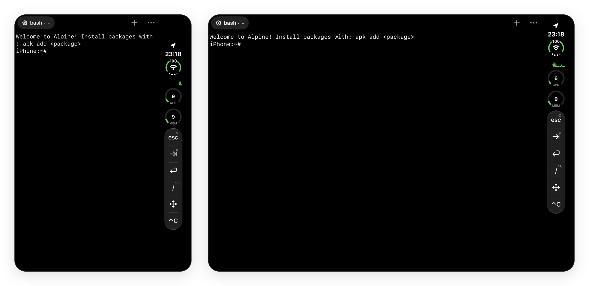
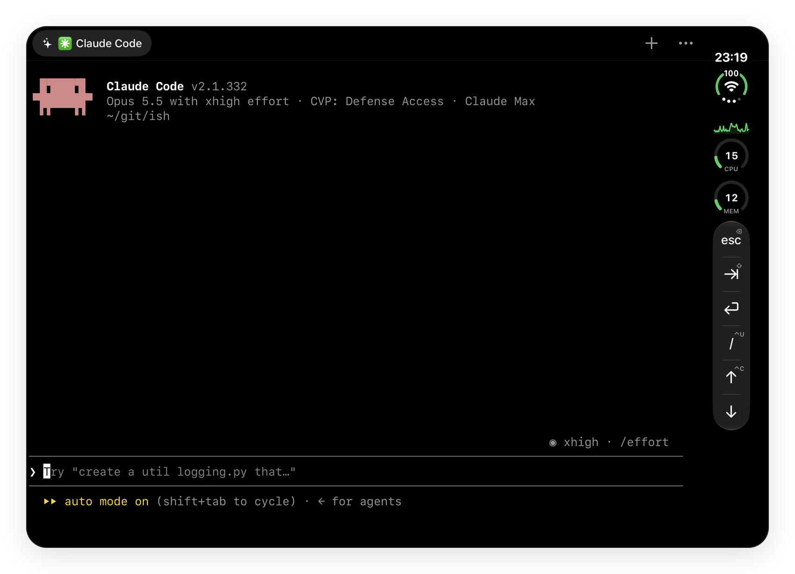

# [iSH](https://ish.app)

> ## 🚀 ARM64 分支说明
>
> **本仓库是 [ish-app/ish](https://github.com/ish-app/ish) 的分支**，在 iPhone 和 iPad 上运行
> **AArch64 Linux**，优先为**折叠屏 iPhone** 设计。客体只有 AArch64：上游的 x86（i386）客体和
> Linux 内核变体（iSH+Linux）都已移除。
>
> **客体代码有三种运行方式**，后一种接手前一种做不了的：
> - **AOT 镜像**：bash、busybox、musl、Python、Node.js、Claude Code、JVM、git、gh、OpenSSH 和
>   OpenSSL 中要紧代码的原生翻译，由 CI 录制并链接进 App，不需要任何额外条件就以原生代码运行。
> - **内置 JIT**（`asbestos/guest-arm64/jit.c`）：运行时翻译其余代码，放进一块 iOS 在调试器挂过
>   App 之后才允许执行的代码区（iOS 26 有 TXM 的设备上，还要由调试器准备好这块区）。iSH 自己当
>   自己调试器的客户端：App 的扩展经回环 VPN 连到设备自身的服务，挂上
>   [StikJIT](https://github.com/zhkl0228/StikJIT)，准备好代码区后脱离，在 App 启动几秒之后进行。
>   需要开发者模式、用开发证书签名的 App 和配对文件；iOS 27 上 iSH 可以在设备本机完成配对
>   （设置 → Built-in JIT）。
> - **Asbestos**：上游的线程化代码解释器，加上本分支手写的 ARM64 gadget，每条客体指令只需几条
>   主机指令，不需要可执行内存。JIT 拿到代码区之前、或者没有代码区时，所有代码都在这里运行。
>
> **另外：**
> - **48 位虚拟地址空间**：4 级页表，V8、Go、Rust 的运行时都能跑
> - **Alpine 3.24** 根文件系统上的 **`ish-install`**：Python 3.14、Node.js 24、Claude Code、
>   Kimi Code、Go、OpenJDK 25、gcc、clang、Redis 和 MariaDB，可按组装也可全装（`--cn` 用国内
>   镜像），root 的登录 shell 可选 bash、zsh 或 fish
> - **完整的 NEON + Crypto**：AES、SHA、CRC32 指令，用于 TLS 和哈希
> - **折叠屏 iPhone 的右边栏**：iOS 留给状态栏的右侧一列显示设备的 CPU、内存和 JIT 圆环，以及随
>   当前程序变化的按键（esc、tab、回车、/；方向盘和 Ctrl-C，AI 智能体则是上下箭头；vi 的 `:`，
>   分页器的空格和 q）
> - **终端**：标签页按上次的目录恢复、剪贴板历史、程序发出的通知（响铃、OSC 9 和 777）、与键盘
>   同宽的键盘栏
> - **智能体集成**：`ISHShellExecutor`（Obj-C shell API）、`DebugServer`（基于 HTTP 的
>   JSON-RPC）、`Native Offload`（指定程序绕过仿真）、宿主与客体共享文件的绑定挂载
>
> **安装：** CI 发布的 ipa 不签名，各个 bundle 要开哪些能力见[签名](README_arm64_zh.md#签名)。
>
> **完整文档：** [README_arm64_zh.md](README_arm64_zh.md) · [English](README_arm64.md) ·
> [性能报告](benchmark/BENCHMARK_PERF.md) · [兼容性报告](benchmark/BENCHMARK_COMPAT.md)

 
折叠与展开：iOS 留给状态栏的那一列里的圆环和按键

 
用 <code>ish-install claude</code> 装好的 Claude Code，右边栏换成了智能体用的按键

iSH 是一个运行在 iOS 上的 Linux shell。本项目使用了 AArch64（ARM64）用户模式仿真和系统调用翻译转换。iSH 只能在 AArch64 主机上构建和运行：Apple silicon Mac、iPhone/iPad，或 arm64 Linux（命令行工具）。

请查看 issue 和提交记录以了解本项目当前的状态。

- [App Store 页面](https://apps.apple.com/us/app/ish-shell/id1436902243)
- [Testflight 测试（ARM64 分支）](https://testflight.apple.com/join/ZtGfhNkH)
- [Discord 服务器](https://discord.gg/HFAXj44)
- [维基帮助与教程](https://github.com/ish-app/ish/wiki)

# 上手

本项目下包含了其他 git 项目作为子模块（libarchive，以及 App 内置 JIT 用的 StikJIT 和 idevice），请确保在克隆时使用参数`--recurse-submodules`，即 `git clone --recurse-submodules https://github.com/ish-app/ish.git`。或是在克隆好了之后执行 `git submodule update --init`。

编译此项目需要以下依赖:

 - Python 3
    + Meson (`pip3 install meson`)
 - Ninja 请查看[此处](https://ninja-build.org/)
 - Clang and LLD (在安装了 `brew` 的 macOS 系统上运行 `brew install llvm`。在 Linux 系统上请根据你的包管理器，选择运行相应的安装命令 `sudo apt install clang lld` 或者 `sudo pacman -S clang lld`)
 - libarchive (在 macOS 系统上使用 `brew install libarchive` 或 `sudo port install libarchive` 来安装。在 Linux 系统上请根据你的包管理器，选择运行相应的安装命令如 `sudo apt install libarchive-dev` 来安装)
 - 编译 iOS 应用还需要：xcodegen（`brew install xcodegen`），以及带 `aarch64-apple-ios` 目标的 rustup（`rustup target add aarch64-apple-ios`）

## 创建iOS应用

使用 Xcode 打开项目，选择 iSH.xcconfig，并且修改 `ROOT_BUNDLE_IDENTIFIER` 为你的[唯一值](https://help.apple.com/xcode/mac/current/#/dev91fe7130a)。此外，还需要在项目（project）的构建设置（build settings）中更新开发团队 ID，注意这里指的不是目标（target）的构建设置（build settings）。先运行一次 `app/StikJIT/build.sh`（从 `deps/` 编译 StikJIT 和它用的 idevice）和 `app/idevice/build.sh`（设备内配对用的 idevice），CI 也是这么做的；然后选择 `iSH-ARM64` scheme 并点击 `运行`，之后应该有脚本帮你自动执行相关操作（包括下载 App 自带的根文件系统和 AOT 镜像）。如果遇到了任何问题，请提交 issue，我们会帮你解决。

## 为测试构建命令行工具

在项目目录中运行命令 `meson setup build`，之后 `build` 目录会被创建。进入到 `build` 目录并运行命令 `ninja`。

为了建立一个自有的 Alpine linux 文件系统，请从 [Alpine 网站](https://alpinelinux.org/downloads/) 下载 `Alpine minirootfs tarball for aarch64` 并运行 `tools/fakefsify` 。将 minirotfs tarball 指定为第一个参数，将输出目录的名称（如`alpine`）指定为第二个参数，即 `tools/fakefsify $MinirotfsTarballFilename alpine` 然后在 Alpine 文件系统中运行 `/ish -f alpine/bin/sh`。如果 `build` 目录下找不到 `tools/fakefsify`，可能是系统上找不到 `libarchive` 的依赖（请参照前面的章节进行安装）。

## 日志

在编译过程中，iSH 提供数种日志类型，默认情况下它们都被禁用，想要启用它们需要:

- 在 Xcode 中将 iSH.xcconfig 中 `ISH_LOG` 设置为以空格分隔的日志类型列表。
- 在 Meson (测试使用的命令行工具) 中执行命令 `meson configure -Dlog="<space-separated list of log channels>"`。

可用的日志类型:

- `strace`: 最有用的类型，记录几乎每个系统调用的参数和返回值。
- `instr`: 记录模拟器执行的每个指令，这会让所有执行变得很慢。
- `verbose`: 记录不属于其他类别的调试日志。
- 使用 `grep` 命令查看 `DEFAULT_CHANNEL` 变量，以确认在更新此列表后是否添加了更多日志频道。

# 关于解释器

可能我在写 iSH 中最有趣的部分就是解释器了。实际上它不是真正的 JIT，因为它不并以机器代码为目标，而是生成一个称为 gadgets 的函数指针数组，并且每个 gadget 都以对下一个函数的尾调用结束，类似于一些 Forth 解释器使用的线程化代码技术。好处就是，与纯仿真相比，它的速度提高了 3-5 倍。

但不幸的是，我最开始决定用汇编语言编写几乎所有的 gadgets。这可能从性能方面来说是一个好的决定（虽然我永远也无法确定），但是对可读性、可维护性和我的理智来说，这是一个可怕的决定。我承受了大量来自编译器、汇编程序以及链接器的乱七八糟的东西。那里面就像有一个魔鬼，把我的代码搞得畸形，就算没有畸形，也会编造一些愚蠢的理由说它不能够编译。为了在编写代码时保持理智，我不得不忽略代码结构和命名方面的最佳实践。你会发现宏和变量具有诸如 `ss`、`s` 和 `a` 等描述性的名称，并且汇编器的宏嵌套层数超乎你的想象。最重要的是，代码中几乎没有任何注释。

所以这是一个警告: 长期接触此代码可能会使你失去理智，对 GAS 宏和链接器错误产生噩梦，或是任何其他使人虚弱的副作用。在加利福尼亚，众所周知这样的代码会导致癌症、生产缺陷和重复伤害。
