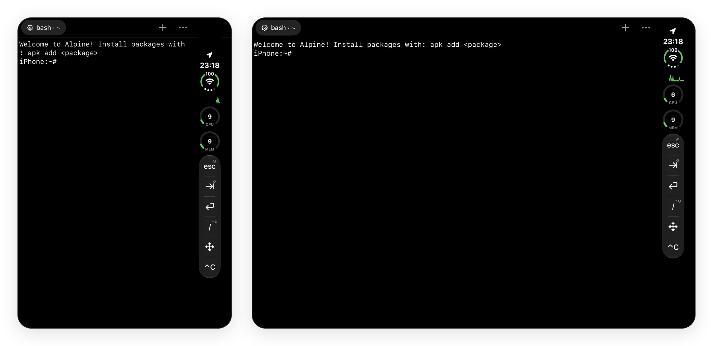

# iSH ARM64 — Linux on iOS via Native Threaded-Code Interpreter

**Fork of [ish-app/ish](https://github.com/ish-app/ish)** — a userspace Linux emulator for iOS.

This fork adds a **native ARM64 guest backend** to upstream iSH's threaded-code interpreter
(*Asbestos*, formerly called *jit* — renamed upstream in 2024 because it doesn't actually emit
machine code). The new backend emulates AArch64 Linux on Apple Silicon; the original x86
(i386) guest backend it was built beside, and upstream's Linux-kernel variant (iSH+Linux), have
since been removed, so the guest is AArch64 only. The result is a dramatically faster and more
compatible Linux environment capable of running **Python, Node.js, Go, Rust, and native
CLI tools** directly on iPhone and iPad.

<p align="center">

</p>

> ## 🚢 Production Use
>
> This engine is shipping in **[OpenMinis](https://openminis.app)** as the **Agent Shell Sandbox**,
> where it has been **stably used by over 10,000 users** to run Linux tools and shell workloads
> on iOS. The numbers and stability claims in this README are grounded in that real-world
> deployment, not just synthetic benchmarks.

> **Naming note**: *Asbestos* is the upstream project's name for its threaded-code
> interpreter (see the upstream commit [`d375656f` "Rename the JIT"](https://github.com/ish-app/ish/commit/d375656f)
> from June 2024). Asbestos itself emits no machine code: for each basic block it builds an
> array of pointers to pre-compiled native "gadget" functions that tail-call one another (the
> technique Forth interpreters use). This fork adds an **ARM64 guest backend** inside it: new
> gadgets (`asbestos/guest-arm64/gadgets-aarch64/`) that map AArch64 guest instructions to a
> few ARM64 host instructions each.
>
> On top of Asbestos, this fork has a **native JIT** (`asbestos/guest-arm64/jit.c`), which does
> emit machine code: it runs the **AOT images** the app links in, and translates other code at
> run time once iOS lets the app run code it writes (see [Built-in JIT](#built-in-jit)). Below,
> "JIT" means that one; Asbestos is "the gadgets".

---

## Why ARM64?

The original iSH translates **x86 (i386) instructions** on an ARM64 host — every guest instruction
must be cross-architecture decoded and emulated. This works well for simple tools but creates
fundamental limits:

| Limitation | x86 (upstream iSH) | ARM64 (this fork) |
|---|---|---|
| Architecture translation | i386 → ARM64 (cross) | AArch64 → AArch64 (same) |
| Address space | 32-bit (4 GB) | 48-bit (256 TB) |
| SIMD | Partial SSE/SSE2 | Full NEON + Crypto |
| Node.js / V8 | Not possible (needs >4 GB VA) | Supported |
| Go / Rust | Not possible (large VA requirements) | Supported |
| Compute overhead | 15-100x native | 3-30x native |

## Architecture Overview

```
+--------------------------------------------------------------+
|  iOS App (iSH ARM64)                                         |
|                                                              |
|  +--------------------------------------------------------+  |
|  |  Asbestos (threaded-code interpreter)                  |  |
|  |                                                        |  |
|  |   Decoder  -->  Gadget program  -->  Fiber Blocks      |  |
|  |   (gen.c)       builder              (block cache)     |  |
|  |                                                        |  |
|  |   Native JIT (jit.c): AOT images linked into the app,  |  |
|  |   and code translated at run time in its code region   |  |
|  |                                                        |  |
|  |   --- 48-bit Virtual Memory (4-level page table) ---   |  |
|  |       TLB (8192 entries) + CoW + Lazy Reservations     |  |
|  +--------------------------------------------------------+  |
|                                                              |
|  +-------------------+    +-------------------------------+  |
|  |  Linux Kernel     |    |  Agent Integration            |  |
|  |  (syscalls,       |    |  - ISHShellExecutor           |  |
|  |   signals,        |    |  - DebugServer (JSON-RPC)     |  |
|  |   futex, epoll)   |    |  - Native Offload             |  |
|  +-------------------+    |  - Bind Mounts                |  |
|                           +-------------------------------+  |
|  +-------------------+                                       |
|  |  Filesystem       |                                       |
|  |  fakefs + realfs  |                                       |
|  |  + bind mounts    |                                       |
|  +-------------------+                                       |
+--------------------------------------------------------------+
```

---

## Key Changes from Upstream

### 1. ARM64 Guest Backend inside Asbestos

This fork's main contribution. It plugs into upstream Asbestos (the existing threaded-code
interpreter) and replaces the per-instruction cost model: for each guest basic block the new
backend builds a **gadget program** — an array of `unsigned long` values alternating pointers
to pre-compiled ARM64 gadget functions with inline operands. Execution is a chain of tail
calls — each gadget loads the next pointer from the program stream and branches to it
(`br x8`). No executable memory is allocated, no machine code is generated at runtime.
(The native JIT on top of it, `asbestos/guest-arm64/jit.c`, runs the AOT images the app links
in, and translates at run time only when a debugger has had the app, which iOS requires for it:
Xcode, or the app's own JIT helper (see [Built-in JIT](#built-in-jit)). From iOS 26 on A15/M2
and later (TXM) the debugger must also allocate the code region, which iSH asks for by iOS 26's
JIT protocol: the helper's StikJIT answers it with its `universal.js`. `/proc/ish/jit` says
where the region came from, or why there is none.)
The host-code overhead per guest instruction is a few ARM64 instructions inside the
corresponding gadget.

**Key files:**
- `asbestos/asbestos.c` — Block cache, block management, RCU-like jetsam cleanup
- `asbestos/guest-arm64/gen.c` — Instruction decoder + gadget program builder (~200+ opcodes)
- `asbestos/guest-arm64/gadgets-aarch64/` — Hand-written ARM64 assembly gadgets:
  - `entry.S` — fiber_enter/exit, crash recovery trampoline
  - `memory.S` — Load/store with inline TLB lookup (~12 instructions fast path)
  - `control.S` — Branches, conditionals, fused compare-and-branch
  - `math.S` — Arithmetic, shifts, bit manipulation, NEON/SIMD
  - `crypto.S` — AES, SHA, CRC32 instructions

**Design highlights:**
- **Block chaining**: Sequential basic blocks link directly, skipping dispatch overhead
- **Persistent TLB**: 8192-entry TLB survives across syscalls (not flushed on every entry)
- **Crash recovery**: SIGSEGV inside a gadget redirects to a trampoline for CoW resolution
- **Full NEON**: All 128-bit SIMD operations including crypto extensions

### 2. 48-bit Virtual Address Space

4-level page table (L0→L1→L2→L3, 9 bits each = 36-bit page number + 12-bit offset = 48 bits).

- Supports V8's 128GB+ pointer cage (via `MAP_NORESERVE` lazy reservations)
- Go's large virtual address requirements for heap/stack
- Guard pages at 0x0-0x100000 for V8 compressed pointer safety
- Layout kept compact (stack at `0xffffe000`, mmap at `0xefffd`) for TLB efficiency

**Key files:** `kernel/memory.h`, `kernel/memory.c`, `emu/tlb.h`

### 3. Node.js / V8 Support

Running Node.js on a userspace emulator required solving multiple V8-specific problems:

- **128GB MAP_NORESERVE**: Lazy address reservations that don't consume physical memory
- **V8 flags for an emulator** (`sys_execve`, for a program named `node`): V8's JIT
  tiers and native regexp code off (`--no-sparkplug --no-maglev --no-opt
  --regexp-interpret-all`), fewer V8 threads, one heap generation. They choose speed and
  memory, not correctness: node runs right with every tier, WebAssembly stays real.
  `ISH_NODE_MODE=jitless` (or `--jitless`) picks the jitless set with a WebAssembly
  polyfill instead. An option the program gives itself, on its command line or in
  `NODE_OPTIONS`, wins over the injected one
- **Exit cleanup**: Safety valves for stuck V8 threads during process exit

**Result**: `npm install`, `npm exec`, `npx`, and `create-next-app` all work.

### 4. Agent Integration

Mechanisms designed for AI agent orchestration on iOS:

#### ISHShellExecutor (`app/ISHShellExecutor.h`)

Objective-C API for programmatic shell execution with streaming output:

```objc
[ISHShellExecutor executeCommand:@"pip install requests"
                    lineCallback:^(NSString *line, BOOL isStdErr) {
                        NSLog(@"%@", line);
                    }
                      completion:^(ISHShellExecutionResult *result) {
                          NSLog(@"Exit code: %d", result.exitCode);
                      }];
```

#### DebugServer (`app/DebugServer.c`)

JSON-RPC over HTTP server for guest introspection:

```bash
# List files
curl localhost:1234 -d '{"jsonrpc":"2.0","id":1,"method":"fs.readdir","params":{"path":"/usr/bin"}}'

# Execute command
curl localhost:1234 -d '{"jsonrpc":"2.0","id":1,"method":"guest.exec","params":{"command":"python3 --version"}}'

# Inspect processes
curl localhost:1234 -d '{"jsonrpc":"2.0","id":1,"method":"task.list"}'
```

#### Native Offload (`kernel/native_offload.c`)

Bypass emulation entirely for registered binaries. Guest `execve()` is intercepted and
routed to a native handler or host binary:

```c
// Register handler (call once at startup)
native_offload_add_handler("ffmpeg", ffmpeg_main);

// Now guest `ffmpeg -i input.mp4 output.mp3` runs natively
// Arguments auto-translated from guest paths to host paths
```

Supports both in-process handlers (iOS + macOS) and `posix_spawn` delegation (macOS CLI).

#### Bind Mounts (`fs/fake.c`)

Mount host directories into the guest filesystem:

```c
// Read-only bind mount of host directory
fakefs_bind_mount("/host/path/to/data", "/mnt/data", /*read_only=*/true);
```

Enables AI agents to share files between the host app and the Linux guest without copying.

### 5. Rootfs Management

- **Alpine 3.24 aarch64** with full apk package manager (`tools/build-rootfs.sh`), with
  only everyday tools preinstalled; `ish-install` installs the development tools when wanted
  (Python, Node.js and Claude Code, Go, Java, C/C++, clang, Redis and MariaDB), all of them
  or by group (`ish-install go python`; `ish-install -l` lists the groups). After an app
  update whose AOT images were recorded on newer versions, every login shell names what they
  serve only in part, and `ish-install -u` installs their versions (Claude Code and Kimi Code
  where they are, an older apk package upgraded; one a mirror of `--cn` has not yet, from the
  official npm registry or Alpine repositories)
- **RootfsPatch.bundle**: Versioned overlay system for incremental rootfs updates
- **Polyfills**: WebAssembly polyfill for undici/llhttp, fetch polyfill for HTTP downloads
- No environment variables injected: a program sees the environment it was started with

---

## Build Configuration

| Target | Scheme | xcconfig | Guest Arch | Bundle ID Suffix |
|--------|--------|----------|------------|------------------|
| ARM64 | iSH-ARM64 | `AppARM64.xcconfig` | aarch64 | `.arm64` |
| ARM64 + FFmpeg | iSH-ARM64-ffmpeg | `AppARM64-ffmpeg.xcconfig` | aarch64 | `.arm64` |

The ARM64 target links meson-built libraries (`libish.a`, `libish_emu.a`, `libfakefs.a`) directly
from the meson build dir, bypassing Xcode's auto-discovery of the library targets.

iSH builds and runs on an AArch64 host only (Apple silicon, an iPhone or iPad, an arm64 Linux).

```bash
# Build the CLI (macOS or arm64 Linux, for testing)
meson setup build-arm64-release --buildtype=release
ninja -C build-arm64-release

# Run
./build-arm64-release/ish -f ./alpine-arm64-fakefs /bin/sh
```

### Built-in JIT

The iSH-ARM64 app embeds two extensions for it: `iSHJITHelper-ARM64` (`app/JITHelper`), which
attaches StikJIT's debugger to iSH, gives it its code region and lets it go, and
`iSHLoopbackTunnel-ARM64` (`app/LoopbackTunnel`), the loopback VPN StikJIT reaches the device's
own services through, up only while the helper needs it. StikJIT is
[zhkl0228/StikJIT](https://github.com/zhkl0228/StikJIT) (`deps/StikJIT`): one tunnel to the
device for the DDI check and the debug session, the code region's pages written with their answers
read many at a time. It links idevice (Rust) built from
[zhkl0228/idevice](https://github.com/zhkl0228/idevice)'s `stikjit` branch (`deps/idevice`),
the tunnel's TLS and TCP compiled for speed. Run `app/StikJIT/build.sh` (it needs `xcodegen` and
`rustup` with `aarch64-apple-ios`) and `app/idevice/build.sh` (idevice again, for the on-device
pairing) once before building the app in Xcode; CI runs both.

In Settings → Built-in JIT, get the device's pairing file: on iOS 27, Pair This Device (iSH
advertises itself as a computer; tap "Pair with iSH" in Settings › Privacy & Security › Developer
Mode and type the code iSH shows), or import one made on a computer with `idevice_pair`. Then
enable it, now or as iSH starts: then three seconds after the start, once the app's own launch is
done, so the two do not peak together. iSH starts without it, and the programs compiled once the
helper has given the JIT its code region run as native code. The region's size is a setting
(128 MB by default, in arenas of 128 MB): enabling the JIT takes about a second for the attach,
which debugserver waits out, and half a second per 512 MB, a byte written in each of its 16 KB
pages. `/proc/ish/jit` says where the region came from, or why there is none, and the helper's
last steps with their times. It needs Developer Mode, the app signed with a development profile
(`get-task-allow`), and the Network Extensions capability for the app and its tunnel.

### Tests

```bash
# Regression tests: small guest programs, each pinning a fixed bug. They are
# built with $CC_GUEST (default aarch64-linux-musl-gcc) and run in a plain
# (non-fakefs) aarch64 rootfs.
tests/regress/run.sh -i build-arm64-release/ish -r ./alpine-arm64-plain

# Smoke test: python/pip, node/npm, go, git and Claude Code doing real work in
# a rootfs made by tools/build-rootfs.sh (installed first with ish-install).
# Needs the network.
tests/smoke/run.sh -i build-arm64-release/ish -f ./alpine-arm64-fakefs
```

CI (`.github/workflows/ci.yml`) archives the app for a phone (unsigned) on macOS and makes
its ipa (`app/package-ipa.py`), and on an arm64 Linux runner runs `tests/regress/ci.sh`: the
CLI built as a release with no warning, then the regression tests on an Alpine aarch64
minirootfs. A push to master publishes the ipa and its dSYMs as a release,
`ipa-<version>-<build>`, when that version is not published yet (`MARKETING_VERSION` and
`CURRENT_PROJECT_VERSION` in `app/AppARM64.xcconfig`, which `app/FileProviderARM64.xcconfig`
must match), or again, replacing it, when a commit of the push has `[ipa]` in its message
(or the workflow is run by hand with `force`). A set of AOT images CI commits
(`.github/workflows/aot-images.yml`) raises the build by one, so its app is published as a new
build. The newest five are kept, and the newest is at
`releases/latest/download/iSH-ARM64-unsigned.ipa`. It is unsigned: sign it with your own
developer account to install it.

`uname -v` (and `/proc/version`) says which build runs: `#1 SMP iSH 2.1.0 (806) <commit>
<commit date>` (`iSH cli` in the command line tool, `-dirty` after a commit built with
changes); `/proc/ish/version` says the same and the JIT's abi, which an AOT image must match.
`uname -r` stays `4.20.69-ish`: programs read it to tell what the kernel has.

**AddressSanitizer.** A heap overflow or use-after-free in iSH itself usually
crashes it later, somewhere in `malloc` or `free`, or not at all.
`tools/build-asan.sh` builds an ASan `ish`, which stops at the bad access and
says where it happened and where the memory was allocated and freed:

```bash
tools/build-asan.sh build-asan
tests/regress/run.sh -i build-asan/ish -r ./alpine-arm64-plain
tests/smoke/run.sh -i build-asan/ish -f ./alpine-arm64-fakefs
```

Both test scripts notice an ASan build and fail on any report. The ASan options
iSH needs are built into the binary; `ASAN_OPTIONS` adds to them. With a clang
that has no ASan runtime of its own (Ubuntu's), the script links gcc's
`libasan`.

---

## Performance

Measured with `benchmark/run.sh` on macOS 26.4.1 / Apple Silicon using guest-side
timing (startup overhead excluded), when this fork still built upstream's x86 backend
beside the ARM64 one: the x86 columns are that backend's. `benchmark/run.sh` now compares
ARM64 with native only. Full details in
**[benchmark/BENCHMARK_PERF.md](benchmark/BENCHMARK_PERF.md)**.

### Overhead vs Native (by workload)

| Category | x86/Native | ARM64/Native | **ARM64 vs x86** |
|---|:---:|:---:|:---:|
| C (pure compute) | 13-212x | 0.5-30x | **0.5-3.8x** |
| Shell pipelines | 2-164x | 1-127x | **1.0-4.3x** |
| Python | 5-77x | 2-77x | **1.7-3.2x** |
| Go (startup) | 2.6-6.2x | 2.4-5.5x | **1.1x** |
| Node.js | 7-25x | 5-22x | **0.5-1.3x** |

### Headline numbers (compute-heavy)

- **Shell `seq+awk 100K`**: ARM64 **4.2x faster** than x86 (828ms vs 3447ms)
- **C `int_arith_2M`**: ARM64 **3.8x faster** (62ms vs 233ms)
- **Shell `grep count`**: ARM64 **3.6x faster** (49ms vs 174ms)
- **Python `sort 100K`**: ARM64 **3.2x faster** (1570ms vs 5053ms)
- **Python `json roundtrip`**: ARM64 **2.5x faster** (1270ms vs 3149ms)
- **Crypto `md5sum`**: ARM64 **2.2x faster** with hardware crypto (6ms vs 13ms)

> **Why ARM64 wins**: same-architecture gadget dispatch (each guest instruction costs only a
> few ARM64 host instructions inside its gadget), full NEON + crypto extensions, 48-bit
> address space for V8/Go/Rust, and Node.js-specific fixes (V8 flags, io_uring
> syscall). On a few microbench cases the x86 interpreter is
> competitive or faster (Node.js `sum 1M`, `JSON 10K`, C `mem_seq`/`func_call`) — typically
> small allocations or tight loops where the JIT's per-block compile cost isn't amortized.

## Compatibility

223 tests across 18 categories (Core OS, FileOps, Text, Build, Python, Node.js, Go/Rust/Perl/…,
Network, VCS, Editors, Shell, DB, Media, Crypto, SysMon, Debug, PkgMgr, Signal). Both
architectures tested under fakefs with the same installed package set, when the fork still
built the x86 backend (`benchmark/run.sh` now tests ARM64 only). Full report:
**[benchmark/BENCHMARK_COMPAT.md](benchmark/BENCHMARK_COMPAT.md)**.

| Architecture | Pass | Fail | Rate |
|---|:---:|:---:|:---:|
| **x86** (Jitter, threaded-code) | 221 | 2 | **99%** |
| **ARM64** (Asbestos, threaded-code) | 223 | 0 | **100%** |

**x86's 2 failures** are DNS lookups (`nslookup localhost`, `nslookup 8.8.8.8`)
— missing bind-tools/resolver in the x86 minirootfs, not an emulation bug.

---

## Supported Software

### Fully Working

| Category | Examples |
|----------|---------|
| **Package managers** | apk, pip, npm, npx, uv |
| **Languages** | Python 3.14, Node.js 24, Go, Java (OpenJDK 25), Perl, Ruby, Lua |
| **AI agents** | Claude Code, Kimi Code (`ish-install claude kimi`) |
| **Dev tools** | git, curl, wget, ssh, vim, nano |
| **Build tools** | gcc, g++, cmake, make, meson |
| **Data tools** | sqlite3, jq, yt-dlp, ffmpeg (via native offload) |
| **Network** | curl, wget, dig, netstat, ss |
| **Node frameworks** | Express, Koa, Fastify, Axios, Socket.io |
| **npm ecosystem** | lodash, moment, dayjs, uuid, chalk, commander, glob, semver |

### Not Supported

- **GUI applications** (no X11/Wayland)
- **Docker / containers** (no kernel namespace support)
- **Kernel modules** (userspace emulator)
- **Hardware access** (no /dev/gpu, no USB passthrough)

---

## Commit History

Major milestones (`git log` has the rest):
1. **Interpreter foundation**: fiber_enter/exit, basic block compilation (to gadget program), TLB
2. **Instruction coverage**: 200+ ARM64 opcodes including full NEON/Crypto
3. **48-bit address space**: 4-level page table, lazy reservations
4. **Node.js support**: V8 guard pages, MAP_NORESERVE, binary patch, exit cleanup
5. **Go support**: Signal frame alignment, sigreturn fixes, NZCV preservation
6. **Rust/uv support**: FUTEX_WAIT_BITSET, PMULL, BFM, demand-mapped reads
7. **Agent integration**: ISHShellExecutor, DebugServer, Native Offload, Bind Mounts
8. **Stability**: 50+ bug fixes for concurrency, memory leaks, use-after-free, deadlocks
9. **Native JIT and AOT images**: native code at run time in a debugger-prepared code region, and
   recorded translations of bash, Python, Node.js, Claude Code and more linked into the app
10. **Built-in JIT helper**: StikJIT through a loopback VPN, the device's pairing done on the device
11. **Foldable iPhone**: the status bar's column for meters and the keys that follow what runs

---

## Project Structure

```
iSH/
├── asbestos/                    # ARM64 threaded-code interpreter
│   ├── asbestos.c/h             # Block cache, RCU cleanup
│   └── guest-arm64/
│       ├── gen.c                # Instruction decoder → gadgets
│       ├── crypto_helpers.c     # AES/SHA/CRC32 helpers
│       └── gadgets-aarch64/     # Assembly gadgets
│           ├── entry.S          # Fiber enter/exit, crash handler
│           ├── memory.S         # Load/store, TLB inline lookup
│           ├── control.S        # Branches, conditionals
│           ├── math.S           # ALU, shifts, NEON/SIMD
│           ├── crypto.S         # AES, SHA, PMULL, CRC32
│           ├── bits.S           # Bitfield operations
│           └── gadgets.h        # Register map, TLB macros
├── emu/
│   ├── tlb.c/h                  # TLB miss handling, cross-page
│   └── arch/arm64/
│       ├── cpu.h                # CPU state (regs, NEON, flags)
│       └── decode.h             # Instruction field extraction
├── kernel/
│   ├── arch/arm64/calls.c       # ARM64 syscall table
│   ├── memory.c/h               # Page table, CoW, fault handling
│   ├── mmap.c                   # mmap, lazy reservations
│   ├── native_offload.c/h       # Binary offload system
│   ├── signal.c/h               # Signal delivery/frame
│   ├── futex.c                  # Futex with pipe wakeup
│   ├── exec.c                   # ELF loader, node's V8 flags
│   └── exit.c                   # Thread cleanup, safety valves
├── fs/
│   ├── fake.c/h                 # fakefs + bind mount support
│   ├── real.c                   # Host filesystem access
│   ├── sock.c/h                 # Socket emulation
│   └── poll.c                   # epoll/poll/select
├── app/
│   ├── AppARM64.xcconfig        # ARM64 build config
│   ├── GuestARM64.xcconfig      # Guest arch definition
│   ├── ISHShellExecutor.h/m     # Shell execution API
│   ├── DebugServer.c/h          # JSON-RPC debug server
│   └── RootfsPatch.bundle/      # Versioned rootfs overlay
└── benchmark/
    ├── run.sh                    # Unified benchmark entry point
    ├── assets/                   # shellbench.sh + cbench_lite + prebuilt binaries
    ├── BENCHMARK_PERF.md         # Performance report
    └── BENCHMARK_COMPAT.md       # Compatibility report
```

---

## License

Same as upstream iSH. See [LICENSE](LICENSE).
